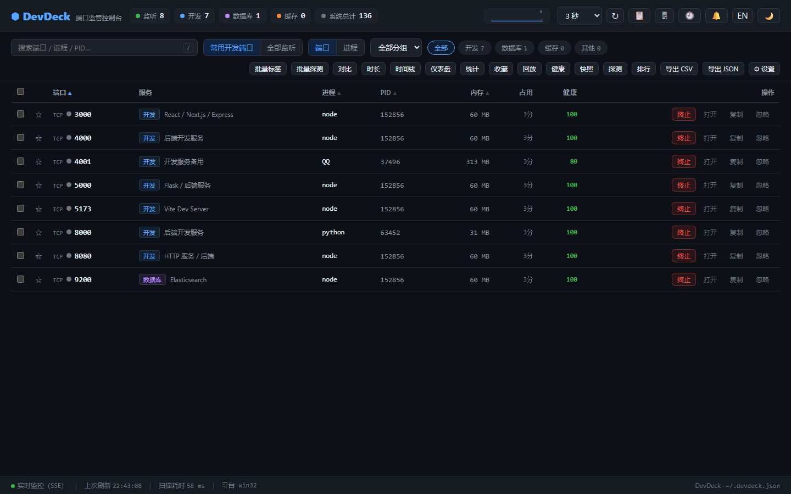

# DevDeck · 开发端口监管控制台

本地端口监控与释放工具：**Web 图形控制台** + **命令行**双形态，零运行时依赖。

用于快速看清「哪个端口被哪个进程占用」，并一键释放。



## 特性

- **跨平台扫描**：Windows 使用 `netstat + PowerShell Get-Process`；macOS/Linux 使用 `lsof -F` / `ss -H`，同时解析 TCP 与 UDP
- **实时监控**：Web 控制台 SSE 优先、轮询兜底；1/2/3/5/10/30 秒可调，可暂停
- **进程识别**：进程名、PID、内存、可执行路径、完整命令行、启动时间、父进程、工作目录
- **一键释放**：单个终止、批量终止、进程树终止，带二次确认与失败详情
- **变化追踪**：新监听 / 已关闭事件持久化到 `~/.devdeck-history.json`，重启保留；新端口 `NEW` 高亮 + 浏览器通知
- **导出**：当前筛选列表导出 CSV / JSON；服务端支持 CSV / JSON / Markdown / HTML / Excel XML
- **个性化**：收藏置顶、忽略列表（可撤销）、端口备注、收藏分组、端口颜色、暗色/亮色/高对比主题、自定义主色
- **可观测性**：占用时长、趋势迷你折线、健康分、内存 Top 10、占用时长排行、连接状态、扫描耗时统计
- **配置与安全**：配置原子写入 + 备份；本地服务绑定 `127.0.0.1`，启动令牌 + Host/Origin/Content-Type 校验
- **单文件 exe**：Windows 下可打包为无需安装 Node 的 `devdeck.exe`

## 与同类工具

DevDeck 不是 npm 库，也不是多主机监控平台，定位是**单机、本地优先的端口监管工具**：

- 比 `get-port` / `kill-port` 多了图形界面、进程详情、历史与导出
- 比 TUI 工具多了浏览器表格、SSE 实时与中英文界面
- 比自托管多主机平台更轻：只监听 `127.0.0.1`，不需要部署 agent

完整对比：https://github.com/xuange-hu/devdeck/blob/main/docs/compare.md

## 安装

```bash
cd devdeck
npm install
npm run build
```

### 全局安装（可选）

```bash
npm link          # 之后可在任意目录直接执行 devdeck
devdeck --help
```

不全局安装也可以直接使用构建产物：

```bash
node dist/cli.js ui
```

## 快速开始

```bash
# 启动 Web 控制台（默认 http://127.0.0.1:7676，自动打开浏览器）
devdeck

# 指定端口 / 不自动开浏览器
devdeck ui -p 7699 --no-open

# 命令行列出常用开发端口
devdeck scan

# 列出全部监听端口
devdeck scan --all

# 按端口或进程名查询
devdeck find 8080
devdeck find node

# 实时监控（每 3 秒刷新）
devdeck watch -i 3 --all

# 终止进程（可一次多个）
devdeck kill 12345 23456

# 终止进程树
devdeck kill 12345 --tree

# 按端口终止占用进程
devdeck kill-port 8080

# 检查端口（退出码 0=空闲 / 1=占用）
devdeck check 8080

# 查找范围内可用端口
devdeck free 8000 8100

# 导出端口列表
devdeck export -f csv -o ports.csv --all
devdeck export -f json -o ports.json
devdeck export -f md -o ports.md --all
devdeck export -f html -o ports.html --all
devdeck export -f xls -o ports.xls --all
```

## Web 控制台功能

| 区域 | 功能 |
|------|------|
| 顶栏 | 监听/开发/数据库/缓存统计、刷新间隔、立即刷新、历史、审计、系统信息、通知、语言、主题 |
| 工具栏 | 搜索（带键盘建议）、范围切换（常用开发端口/全部监听）、分类筛选、收藏分组、批量终止、批量忽略、批量标签、批量探测、对比、时长、时间线、仪表盘、统计、收藏、回放、健康、快照、探测、排行、导出当前列表、设置 |
| 表格 | 收藏、端口+协议+颜色+NEW、分类标签、服务、进程名（点击看详情）、PID、内存、占用、健康分、终止/打开/复制/忽略 |
| 进程视图 | 按进程聚合端口、进程数与总内存 |
| 设置 | 忽略列表（含撤销）、端口告警、自定义关注端口、收藏分组、主题主色、配置导入导出/重置、工作区、启动检查、备份、快捷键、内存阈值、Webhook、快照间隔、报告间隔 |
| 快捷键 | `/` 聚焦搜索、`r` 刷新、`?` 帮助、`j/k` 移动、`x` 勾选、`Enter` 详情、`Esc` 关闭弹窗/建议、双击行编辑备注 |

所有输入框内输入不会被全局快捷键抢走；忽略端口后可在 Toast 中直接撤销。

## VS Code 扩展

仓库内提供可打包的 VS Code 扩展 MVP（`vscode/`）：

- 打开 Web 端口控制台
- 查看全部监听端口
- 按端口终止进程
- 复制端口号

```bash
cd vscode
npx @vscode/vsce package
code --install-extension devdeck-vscode-0.1.0.vsix
```

扩展会自动使用工作区的 `dist/cli.js`；没有本地构建时使用 PATH 中的 `devdeck`。详见 `vscode/README.md`。

## 配置

配置保存在用户主目录 `~/.devdeck.json`，保存时自动写 `~/.devdeck.json.bak`：

```json
{
  "favorites": [8080],
  "ignored": [135, 445],
  "customPorts": [3005],
  "interval": 3,
  "scope": "dev",
  "webhookUrl": "",
  "snapshotInterval": 0,
  "reportInterval": 0
}
```

Web 控制台与 API 均可修改，保存即生效。备注、告警、分组、颜色、快照、工作区、主题/语言等个性化数据保存在浏览器 localStorage；「导出配置」会同时导出服务端配置与这些本地数据。

## HTTP API

服务仅监听 `127.0.0.1`，默认端口 `7676`，被占用时自动顺延。

除 `/api/health` 外，所有 API 都要求启动令牌。页面 HTML 的 `<meta name="devdeck-token">` 会注入令牌：

- 普通请求：`X-DevDeck-Token: <token>`
- SSE / 直接下载：`?token=<token>`

| 方法 | 路径 | 说明 |
|------|------|------|
| GET | `/api/ports?scope=dev\|all` | 端口列表 + 统计 + 元信息 |
| GET | `/api/events?scope=&interval=&token=` | SSE 实时推送（`interval=0` 暂停 data 帧） |
| GET | `/api/history` | 端口变化事件 |
| GET | `/api/audit` | 操作审计 |
| GET | `/api/process?pid=<pid>` | 进程详情 |
| GET | `/api/probe?host=&port=` / `?host=&ports=` | TCP 单端口/批量探测 |
| GET | `/api/sysinfo` | 主机/CPU/内存/负载/IP/运行时长 |
| GET | `/api/connections` | 连接状态统计 |
| GET | `/api/stats` | 扫描耗时统计 |
| GET | `/api/suggest-port?port=` / `?start=&end=` | 端口建议 |
| GET | `/api/export?format=csv\|json\|md\|html\|xls&scope=` | 服务端导出 |
| GET | `/api/export-history?format=csv\|json` | 历史导出 |
| POST | `/api/kill` | 终止进程，body `{ "pids": [123] }` 或 `{ "port": 8080 }` |
| GET / PUT | `/api/config` | 读取 / 更新配置 |
| GET | `/api/health` | 健康检查（无需令牌） |

写操作会校验 `Content-Type: application/json`、`Origin` 与 `X-DevDeck-Token`；非法 Host / 跨站请求会被拒绝。

## 开发

```bash
npm run typecheck   # TypeScript 类型检查（含测试）
npm run build       # tsup 构建 + 复制 Web 资源到 dist
npm test            # 单元 + 前端完整性 + 端到端（38 项）
npm run start       # 运行构建产物
```

## 项目结构

```
devdeck/
├── package.json
├── tsconfig.json
├── tsup.config.ts
├── scripts/copy-web.js      # 构建后复制 Web 资源
├── scripts/build-exe.js     # Node SEA 单文件 exe
├── src/
│   ├── cli.ts               # CLI 入口
│   ├── core/
│   │   ├── ports.ts         # 跨平台扫描、解析、进程详情、终止、探测
│   │   ├── server.ts        # HTTP 服务、API、SSE、历史、审计、定时任务
│   │   ├── config.ts        # 配置原子持久化
│   │   ├── serialize.ts     # CSV/JSON/MD/HTML/XLS 序列化
│   │   └── text.ts          # 终端宽度与对齐
│   └── web/index.html       # Web 控制台（单文件，脚本内联）
└── test/                    # unit / frontend / e2e
```

## 说明

- 终止受系统保护的进程需要管理员权限；失败时会给出明确提示。
- Windows 下进程路径/命令行对部分系统进程可能因权限不可读，属正常现象。
- macOS/Linux 的进程名、命令行、父进程依赖 `ps` / `lsof` 的权限；无权限时对应字段会降级。
- 端口扫描基于系统命令输出，首次扫描在 Windows 上可能需要数秒（PowerShell 枚举进程），之后有缓存。
- 快照与报告默认保留最近 200 个文件，目录分别为 `~/.devdeck-snapshots` 与 `~/.devdeck-reports`。

## 贡献与安全

- 贡献指南：https://github.com/xuange-hu/devdeck/blob/main/CONTRIBUTING.md
- 安全策略与私下报告：https://github.com/xuange-hu/devdeck/blob/main/SECURITY.md
- CI 在 Ubuntu 与 Windows 上分别使用 Node 20/22，执行 `typecheck → build → test`，Linux 额外检查 `npm pack --dry-run`

## 单文件可执行（Windows）

```bash
npm run build:exe
```

生成 `dist/devdeck.exe`（约 90MB，内置 Node 运行时与 Web UI，无需安装 Node 即可运行）。

```bash
dist\devdeck.exe             # 启动 Web 控制台
dist\devdeck.exe scan --all  # 命令行
```

原理：esbuild 打包 CJS → Node SEA 生成 blob → postject 注入 Node 运行时（`scripts/build-exe.js` 自动化）。

## 发布

```bash
npm run build        # 构建
npm test             # 单元 + 前端完整性 + 端到端测试
npm pack --dry-run   # 检查包内容
npm publish          # 发布（需先 npm login）
```

发布包名：`devdeck-cli`，安装后命令名：`devdeck`。单文件 exe 不进入 npm 包，只通过 GitHub Releases 分发。
发布与推广的完整清单：https://github.com/xuange-hu/devdeck/blob/main/docs/route-a-launch.md