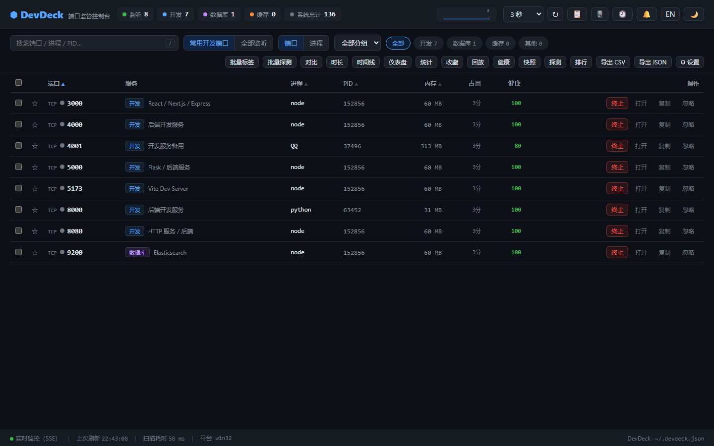

# Show HN: DevDeck – a local port monitor with a web UI and CLI

Every few days I hit the same problem: something is listening on `8080`, `5173`, or `4000`, and I need three commands to find it and kill it. Existing tools are either a GUI, a TUI, an npm library, or a self-hosted multi-host service. I wanted one small local tool that works from both the browser and the terminal.

So I built **DevDeck**: a local port monitor and releaser.



## What it does

- Lists listening TCP/UDP ports with process, PID, memory, age, and a simple health score
- Shows process details: command line, executable path, working directory, parent PID
- Kills one process, selected processes, a whole port, or a process tree
- Pushes updates over SSE, with polling as a fallback
- Highlights new listeners and can send browser notifications
- Exports the current filtered list to CSV/JSON, or the full list to Markdown/HTML/Excel
- Stores history, audit events, snapshots, and first-seen timestamps under your home directory
- Works in English and Chinese; dark/light/high-contrast themes
- Binds to `127.0.0.1` by default, with a startup token and Host/Origin/Content-Type checks

## Install

Windows: download the single-file exe, no Node required:

```text
https://github.com/xuange-hu/devdeck/releases/latest/download/devdeck.exe
```

macOS / Linux / Node users can install the release tarball directly:

```bash
npm install -g https://github.com/xuange-hu/devdeck/releases/download/v0.8.0/devdeck-cli-0.8.0.tgz
devdeck
```

The npm registry package is still in the publishing pipeline. Until then, the release tarball above is the supported install path.

## CLI examples

```bash
devdeck scan --all
devdeck find 8080
devdeck check 8080
devdeck kill-port 8080
devdeck free 8000 8100
devdeck watch -i 3 --all
```

## How it compares

- `get-port` / `kill-port` are libraries; DevDeck is a user-facing tool
- `somo` is a strong TUI; DevDeck adds a browser table, history, and exports
- `portracker` is a self-hosted multi-host service; DevDeck stays local and single-machine

DevDeck deliberately does **not** do remote agents, Kubernetes port ownership, or cloud sync. If those are your needs, portracker or a platform tool is a better fit.

## What I would like to learn

- How do you currently handle port conflicts?
- Which features would you never use?
- Would you rather have this in VS Code, the terminal, or a standalone window?
- Did you hit any parsing issues on macOS/Linux?

Repo: https://github.com/xuange-hu/devdeck

If it saves you one `netstat` round trip, a star helps more people find it.