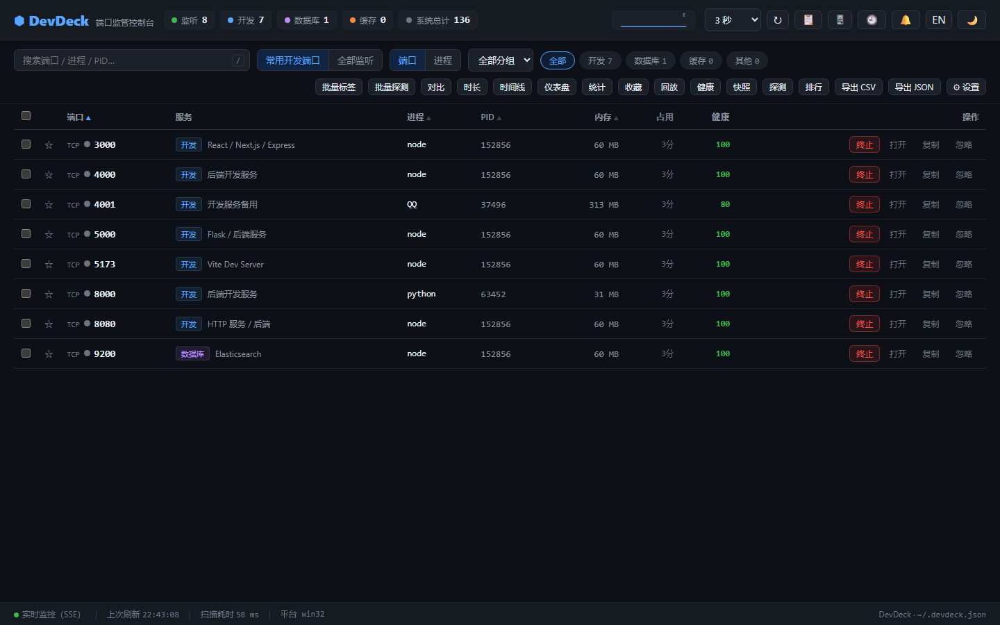

# 我做了个端口监管控制台：Web + CLI，还能打包成一个 exe

每次本地开发，最烦的不是写代码，而是：

- `8080` 被谁占了？
- 刚关掉的服务为什么还占着 `5173`？
- 想释放端口，却要先 `netstat`、再找 PID、再 `taskkill`，三步起步。
- 团队里 Windows / macOS / Linux 混用，命令还不一样。

所以我做了 **DevDeck**：一个本地端口监管控制台，Web + CLI 双形态。



## 它能做什么

启动：

```bash
devdeck
```

浏览器会打开 `http://127.0.0.1:7676`，你可以看到：

- 监听端口、协议（TCP/UDP）、进程名、PID、内存、占用时长、健康分
- 分类（开发 / 数据库 / 缓存 / 其他）、收藏置顶、备注、颜色标记、分组
- 新端口 `NEW` 高亮、SSE 实时刷新、浏览器通知
- 单击进程看详情：路径、命令行、启动时间、父进程、工作目录
- 一键终止、批量终止、按端口终止、进程树终止
- 导出当前筛选列表为 CSV / JSON，或生成 Markdown / HTML / Excel 报告
- 中英文切换、暗色/亮色/高对比主题、移动端自适应

终端里也可以：

```bash
devdeck scan --all
devdeck find 8080
devdeck check 8080
devdeck kill-port 8080
devdeck free 8000 8100
devdeck watch -i 3 --all
```

## 和同类工具的区别

- 不是 npm 库：`get-port`/`portfinder` 是给代码调用的，DevDeck 是给人用的
- 不是纯 TUI：`somo` 终端体验很好，DevDeck 提供浏览器图形界面
- 不是多主机平台：`portracker` 面向自托管/团队，DevDeck 专注单机本地
- 不依赖云端：默认只监听 `127.0.0.1`，数据留在本机
- Windows 可以打包成单文件 exe，不需要安装 Node

详细对比：https://github.com/xuange-hu/devdeck/blob/main/docs/compare.md

## 技术栈

- TypeScript + Node 原生 HTTP，零运行时依赖
- Web 控制台单文件内联，SSE 优先、轮询兜底
- Windows `netstat + PowerShell`；macOS/Linux `lsof -F` / `ss -H`
- 38 项测试：11 单元 + 10 前端完整性 + 17 端到端
- 本地服务带启动令牌、Host/Origin/Content-Type 校验

## 安装

```bash
npm install -g devdeck-cli
devdeck
```

或者从源码构建：

```bash
git clone https://github.com/xuange-hu/devdeck.git
cd devdeck
npm install
npm run build
node dist/cli.js ui
```

Windows 单文件 exe 可从 GitHub Releases 下载，解压后直接运行。

## 我想要什么反馈

- 你平时怎么处理端口冲突？
- 哪些功能你根本不用？
- 你更希望它出现在 VS Code、终端，还是独立窗口？
- 你在 macOS/Linux 上遇到解析问题了吗？

仓库：https://github.com/xuange-hu/devdeck

如果它帮你省过一次 `netstat`，点个 Star 就是最大的支持。